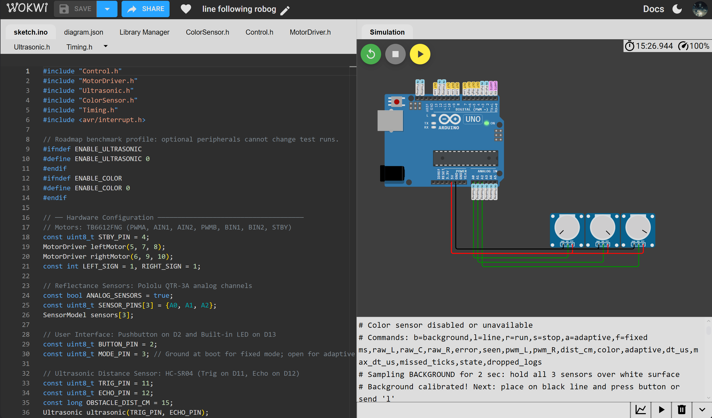

# Autonomous Line-Following Robot

Arduino Uno firmware and analysis tools for a three-channel differential-drive line follower. The controller combines reflectance calibration, PD steering, dynamic PWM and bounded ambient compensation.

**[Run the firmware demo in Wokwi](https://wokwi.com/projects/477942843163696129)**

[](https://wokwi.com/projects/477942843163696129)

Firmware builds and host tests pass. The Wokwi demo exercises calibration, steering and line-loss recovery using three adjustable sensor inputs. See the [demo instructions](docs/WOKWI.md). A moving-robot track simulation is the next milestone; the >98% tracking accuracy and >=30% deviation-reduction figures remain experimental targets.

## Features

- Three analog reflectance channels with two-point calibration.
- PD steering with filtered derivative and reduced speed on curves.
- Fixed/adaptive sensing modes and bounded line-loss recovery.
- Nominal 100 Hz scheduling with timing and dropped-log diagnostics.
- Telemetry analysis that distinguishes sensor proxies from measured physical accuracy.
- Optional ultrasonic obstacle detection and color-marker behavior, disabled by default.

## Repository layout

```text
.github/workflows/       Automated host tests and Uno builds
firmware/LineFollower/   Arduino sketch and controller/driver headers
scripts/                Test runner, telemetry analysis and serial capture
tests/                  C++ and Python regression tests
docs/                   Hardware, operation, roadmap and validation notes
examples/telemetry/     Small documented parser example
reference/              Original six-sensor sketch, archived as text
logs/                   Local trial captures (data files ignored)
```

`build/` contains generated output and local toolchains and is excluded from Git.

## Quick start — no hardware required

Install **Python 3.10+** and a **C++11-capable g++ compiler**. After cloning, open a terminal in the repository folder:

```sh
python scripts/check.py
```

This runs the Python regression suite, compiles/runs the C++ controller and timing tests, and analyzes the example telemetry. On systems where Python is named `python3`, substitute that command. Test output goes into ignored `build/host/`.

To explore only the telemetry analyzer:

```sh
python scripts/analyze_telemetry.py examples/telemetry/sample_telemetry.csv
```

The example is not a measured performance result. Host tests verify software behavior, not robot motion on a track.

## Compile the Uno firmware

Install [Arduino CLI](https://arduino.github.io/arduino-cli/latest/installation/) and ensure `arduino-cli` is on PATH, then run:

```sh
arduino-cli core update-index
arduino-cli core install arduino:avr@1.8.8
arduino-cli compile --fqbn arduino:avr:uno --warnings all firmware/LineFollower
```

The firmware uses the Arduino core and Wire library; no external firmware libraries are required. For the optional ultrasonic/color profile:

```sh
arduino-cli compile --fqbn arduino:avr:uno --warnings all --build-property "compiler.cpp.extra_flags=-DENABLE_ULTRASONIC=1 -DENABLE_COLOR=1" firmware/LineFollower
```

You can also open `firmware/LineFollower/LineFollower.ino` in Arduino IDE and select Arduino Uno. Physical upload is a later step once hardware is available.

## Documentation

- [Wokwi demo](docs/WOKWI.md) — project link, calibration steps and steering checks.
- [Roadmap and specification](docs/ROADMAP.md) — simulation-first next steps and later hardware acceptance gates.
- [Hardware and wiring](docs/HARDWARE.md) — selected Uno, QTR-3A and TB6612FNG configuration.
- [Operation and telemetry](docs/USAGE.md) — calibration, commands and output schema.
- [Validation record](docs/VALIDATION.md) — checks performed and what remains unverified.
- [Trial evidence guidance](logs/README.md) — metadata and external measurement format.
- [Development guide](CONTRIBUTING.md) — checks and contribution conventions.

For future serial capture only, install the optional dependency:

```sh
python -m pip install -r requirements.txt
```

Analysis and host tests use Python's standard library and do not require this package.

## Validation and limitations

GitHub Actions is configured to run host tests and build both Uno profiles on pushes and pull requests. The workflow's first hosted run will occur after publication; no passing CI badge is claimed yet.

The planned simulation will test a model of the robot. Any resulting metrics must be labeled **simulation results** and kept separate from hardware measurements. Motor characteristics, real lighting response, electrical behavior and actual loop timing remain unverified.
